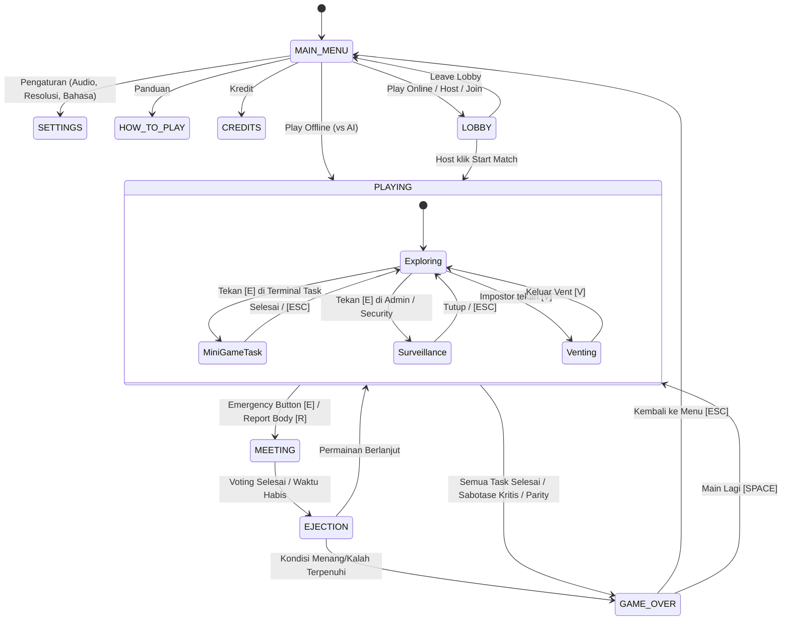
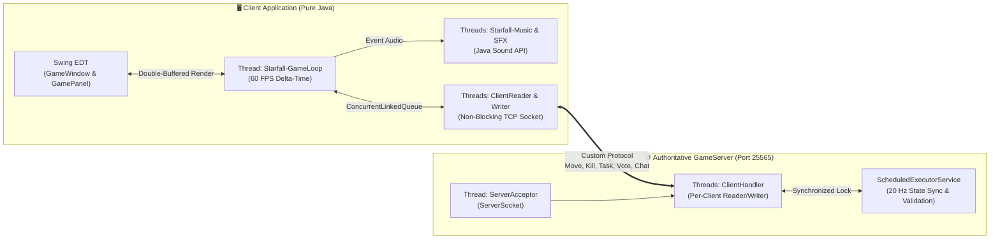
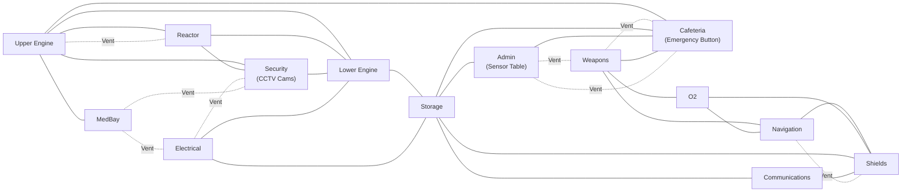

<div align="center">

<!-- Animated Typing Header -->
<a href="#">
  
</a>

<p align="center">
  <b>Game 2D Multiplayer Social Deduction berbasis Pure Java 17+ tanpa game engine eksternal.</b><br/>
  Dibangun dengan Java Swing, Java 2D Graphics, Java Sound API, TCP Sockets, dan Multithreading.
</p>

<!-- Tech & Feature Badges -->
<p align="center">
  
  
  
  
  
  
</p>

<!-- Quick Navigation -->
<p align="center">
  <a href="#-identitas-pengembang">Identitas</a> •
  <a href="#-alur-interaktif--arsitektur">Diagram Interaktif</a> •
  <a href="#-galeri-output-program">Output Program</a> •
  <a href="#-fitur--eksplorasi-sistem">Fitur Lengkap</a> •
  <a href="#-cara-kompilasi--menjalankan">Cara Menjalankan</a>
</p>

</div>

---

## 👨‍💻 Identitas Pengembang

| Informasi | Detail |
| :--- | :--- |
| **Nama Author** | `[Isi Nama Lengkap Anda di Sini]` |
| **NIM** | `[Isi NIM Anda di Sini]` |
| **Universitas** | Universitas Mataram |
| **Fakultas / Prodi** | Fakultas Teknik / Program Studi Teknik Informatika |
| **Mata Kuliah** | Pemrograman Berorientasi Objek (PBO) |
| **Versi Rilis** | `v1.0.0-Release` |

---

## 🌌 Tentang Proyek

**STARFALL: SPACE MYSTERY** adalah game *social deduction* 2D *top-down* berlatar kapal luar angkasa **STARFALL-I** dengan **14 ruangan terhubung**. Pemain dibagi menjadi **Crewmate** (yang harus menyelesaikan berbagai mini-game *task*, memantau CCTV/Admin, dan menemukan penyusup) dan **Impostor** (yang menyabotase sistem kapal, berpindah lewat ventilasi, dan mengeliminasi kru tanpa saksi).

Seluruh sistem—mulai dari *rendering* 60 FPS *delta-time*, animasi karakter & kustomisasi, audio prosedural, kecerdasan buatan (*state-machine AI*), hingga server multiplayer otoritatif—diimplementasikan murni menggunakan pustaka standar **Java SE**.

---

## 🔄 Alur Interaktif & Arsitektur

> 💡 **Tips Interaktif (GitHub):** Arahkan kursor ke pojok kanan atas setiap diagram di bawah ini untuk menggunakan tombol **Zoom In (`+`)**, **Zoom Out (`-`)**, **Geser/Pan**, dan **Reset** agar alur sistem terlihat lebih detail.

### 1. Alur Gameplay & State Machine


### 2. Arsitektur Multithreading & Client-Server Networking


### 3. Peta Konektivitas 14 Ruangan & Jaringan Vent


---

## 📸 Galeri Output Program

> 📁 **Cara Mengisi Gambar:** Simpan tangkapan layar (*screenshot*) hasil programmu di dalam folder **`assets/screenshots/`** dengan nama file sesuai tabel di bawah (atau sesuaikan path-nya).

| Menu Utama & Kustomisasi Karakter | Eksplorasi Kapal (14 Ruangan & Fog of War) |
| :---: | :---: |
| <br/><sub><i>Tampilan 8 menu utama dengan latar bintang & pratinjau karakter</i></sub> | <br/><sub><i>Peta kapal STARFALL-I, pencahayaan dinamis, dan Minimap</i></sub> |
| **Mini-Game Task & Surveillance** | **Emergency Meeting, Chat & Voting** |
| <br/><sub><i>Mini-game interaktif (Wiring, Swipe Card, Asteroids, Reactor)</i></sub> | <br/><sub><i>Layar diskusi chat, konfirmasi voting, dan anonimitas suara</i></sub> |
| **Multiplayer Lobby & Room Code** | **Ejection Cutscene / Victory & Defeat** |
| <br/><sub><i>Lobi LAN/Online dengan 6-digit Room Code dan Roster sinkron</i></sub> | <br/><sub><i>Pengungkapan peran asli seluruh pemain pada layar hasil akhir</i></sub> |

---

## 🧩 Fitur & Eksplorasi Sistem

Klik masing-masing panel di bawah untuk membuka detail sistem:

<details>
<summary><b>🎮 Kontrol Permainan Lengkap</b></summary>
<br/>

| Tombol / Input | Fungsi |
| :--- | :--- |
| `W A S D` / `Arrow Keys` | Menggerakkan karakter / Berpindah jaringan Vent (`A` / `D`) |
| `E` | Interaksi (Buka Task, Tombol Darurat Cafeteria, Perbaiki Sabotase, Admin/CCTV) |
| `R` | Melaporkan mayat terdekat (*Dead Body Report*) |
| `Q` | Mengeliminasi Crewmate dalam jangkauan (*Khusus Impostor*) |
| `V` | Masuk / Keluar ventilasi (*Khusus Impostor*) |
| `1` – `5` | Memicu Sabotase: `[1]` Reactor, `[2]` O2, `[3]` Lights, `[4]` Comms, `[5]` Doors |
| `C` / `H` / `K` / `P` | Ganti Warna (12), Topi (7), Skin (5), dan Pet (3) |
| `F3` / `F11` | Tampilkan/Sembunyikan FPS Debug HUD / Toggle Fullscreen |
| `ESC` | Tutup modal aktif atau kembali ke Main Menu |

</details>

<details>
<summary><b>🛠️ Sistem Task (14 Tugas & Mini-Game Interaktif)</b></summary>
<br/>

| Mini-Game Class | Nama Tugas | Lokasi Ruangan | Mekanik Permainan |
| :--- | :--- | :--- | :--- |
| `WiringTask` | Fix Wiring | Electrical | Sambungkan 4 kabel warna acak kiri ke kanan |
| `CardTask` | Swipe Card | Admin | Gesek kartu ID dengan kecepatan pas (*Too Fast/Slow*) |
| `DownloadTask` | Download & Upload Data | Communications, Admin | Transfer paket data terenkripsi dengan progres animasi |
| `AsteroidsTask` | Clear Asteroids | Weapons | Tembak jatuh 10 asteroid bergerak di radar plasma |
| `ReactorTask` | Start Reactor | Reactor | Uji memori pola keypad 3×3 (4 tahap) |
| `CalibrationTask` | Empty Garbage, Clean O2, Stabilize Steering, Prime Shields, Fuel Engines, Align Engine, Unlock Manifolds, Submit Scan | Cafeteria, O2, Navigation, Shields, Storage, Lower/Upper Engine, MedBay | Kalibrasi 4 modul frekuensi sistem kapal |

</details>

<details>
<summary><b>🚨 5 Jenis Sabotase & Sistem Peran (Crewmate, Impostor, Ghost)</b></summary>
<br/>

- **Reactor Meltdown (`[1]`):** Hitung mundur 30 detik; Impostor langsung menang jika tidak diperbaiki di **Reactor**.
- **Oxygen Depletion (`[2]`):** Hitung mundur 30 detik; Impostor langsung menang jika tidak diperbaiki di **O2**.
- **Lights Sabotage (`[3]`):** Memperkecil radius jarak pandang Crewmate secara drastis hingga diperbaiki di **Electrical**.
- **Communications Sabotage (`[4]`):** Mematikan Minimap dan daftar tugas Crewmate hingga diperbaiki di **Communications**.
- **Door Lockdown (`[5]`):** Mengunci pintu ruangan-ruangan utama selama 10 detik.
- **Ghost Mode:** Pemain yang tereliminasi otomatis menjadi hantu transparan yang dapat menembus tembok untuk memantau permainan dan tetap membantu menyelesaikan sisa tugas.

</details>

<details>
<summary><b>🧠 Kecerdasan Buatan (State-Machine AI)</b></summary>
<br/>

- **Navigasi BFS (`AINavigation`):** Pencarian jalur terpendek lintas 14 ruangan dengan titik aman agar tidak tersangkut meja/peti.
- **`CrewmateAI`:** Menjalankan tugas nyata, bergegas memperbaiki sabotase mematikan, melaporkan mayat yang terlihat, serta memberikan kesaksian chat dan *voting* berbasis bukti visual (tidak curang mengetahui peran pemain lain).
- **`ImpostorAI`:** Memeriksa keberadaan saksi sebelum membunuh, kabur lewat *Vent* terdekat, memicu sabotase secara strategis, berpura-pura mengerjakan tugas (*fake task*), dan membuat alibi saat diskusi.

</details>

<details>
<summary><b>📚 Penerapan Konsep PBO & Java Concurrency</b></summary>
<br/>

- **OOP & SOLID:** Enkapsulasi penuh, pewarisan & polimorfisme pada hierarki `Character` (`Crewmate`, `Impostor`, `Ghost`), kelas abstrak `Task` & `AIController`, serta pemisahan tanggung jawab per paket (*Separation of Concerns*).
- **Java Swing & Java 2D:** `JFrame`, `JPanel` *double-buffered*, *Event Dispatch Thread* (`SwingUtilities.invokeLater`), `Graphics2D`, *Area-union collision*, pencahayaan *Fog of War*, dan `ParticleSystem`.
- **Multithreading & Thread Safety:** `GameLoop` terpisah (60 FPS *delta-time*), `ConcurrentHashMap` & `ConcurrentLinkedQueue` pada `InputManager` dan `GameClient`, `ExecutorService` untuk audio, serta `ScheduledExecutorService` dan blok `synchronized` pada `GameServer`.
- **File I/O:** Penyimpanan otomatis preferensi pemain ke `config/starfall.properties`.

</details>

<details>
<summary><b>📂 Struktur Direktori Proyek</b></summary>
<br/>

```text
STARFALL/
├── assets/
│   └── screenshots/              # Tempat menyimpan gambar output program
├── config/
│   └── starfall.properties       # File konfigurasi otomatis (File I/O)
├── README.md
└── src/
    └── starfall/
        ├── Main.java             # Entry point aplikasi (Swing EDT)
        ├── ai/                   # AIController, AINavigation, AIState, CrewmateAI, ImpostorAI
        ├── audio/                # AudioManager (Java Sound API)
        ├── core/                 # GameConfig, GameEngine, GameLoop, GameState, InputManager
        ├── entities/             # Character, Crewmate, Impostor, Ghost, Player, Cosmetics, PlayerColor
        ├── gameplay/             # TaskManager, KillManager, VentManager, SabotageManager, MeetingManager, VotingManager, WinConditionManager
        ├── graphics/             # Renderer, Camera, SpriteManager, ParticleSystem
        ├── map/                  # GameMap, Room, RoomId, Wall, Door, Vent, InteractiveObject, CollisionManager
        ├── network/              # GameServer, ClientHandler, GameClient, NetworkManager, NetworkMessage
        ├── tasks/                # Task, TaskRegistry, WiringTask, CardTask, DownloadTask, AsteroidsTask, ReactorTask, CalibrationTask
        ├── ui/                   # GameWindow, GamePanel, MainMenu, SettingsScreen, LobbyScreen, MeetingScreen, EjectionScreen, GameOverScreen, SurveillanceOverlay
        └── utils/                # Logger
```

</details>

---

## 🚀 Cara Kompilasi & Menjalankan

### Prasyarat
- **Java Development Kit (JDK) 17 atau lebih baru**

### 1. Kompilasi & Jalankan Game Client
Jalankan perintah berikut dari direktori utama `STARFALL`:

**Windows (PowerShell):**
```powershell
mkdir out -Force
javac -d out (Get-ChildItem -Recurse -Filter *.java src).FullName
java -cp out starfall.Main
```

**Linux / macOS / Git Bash:**
```bash
mkdir -p out
javac -d out $(find src -name "*.java")
java -cp out starfall.Main
```

### 2. Mode Multiplayer (LAN / Online Dedicated Server)
- **Host langsung dari game:** Buka **Main Menu → 2. CREATE PRIVATE ROOM**, catat **6-digit Room Code**, lalu teman lain masuk melalui **3. JOIN ROOM** menggunakan `IP_HOST:25565` dan kode ruangan tersebut.
- **Menjalankan Dedicated Server mandiri (Online):**
```bash
java -cp out starfall.network.GameServer 25565
```

---

<div align="center">
  
  <p><b>STARFALL: SPACE MYSTERY</b> — Crafted with Pure Java ☕</p>
</div>